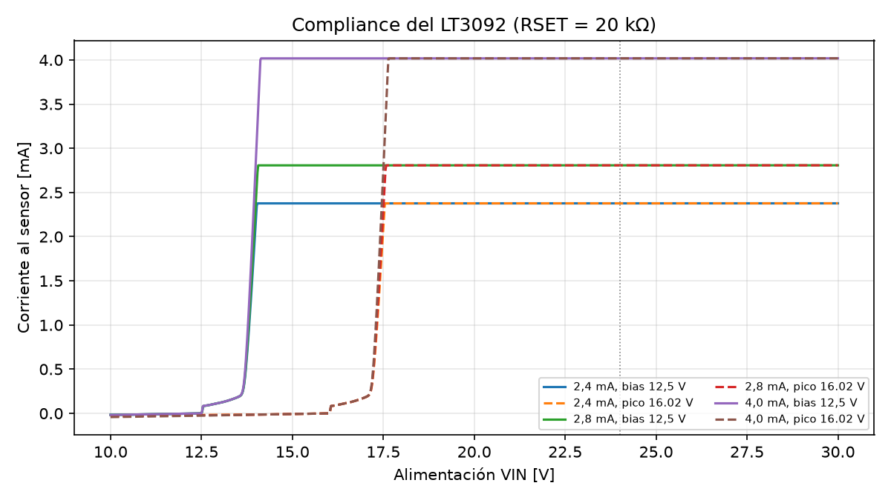
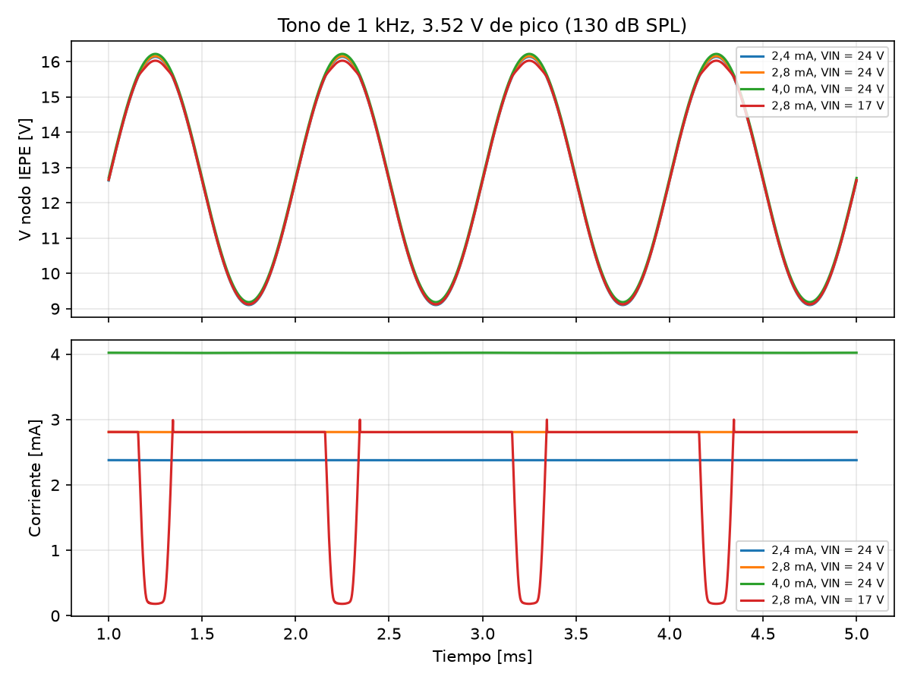
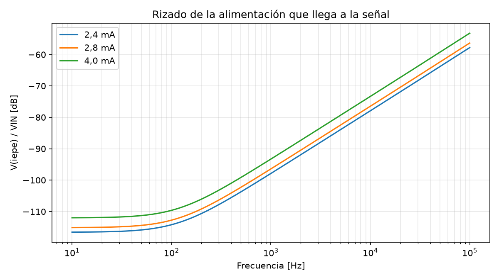
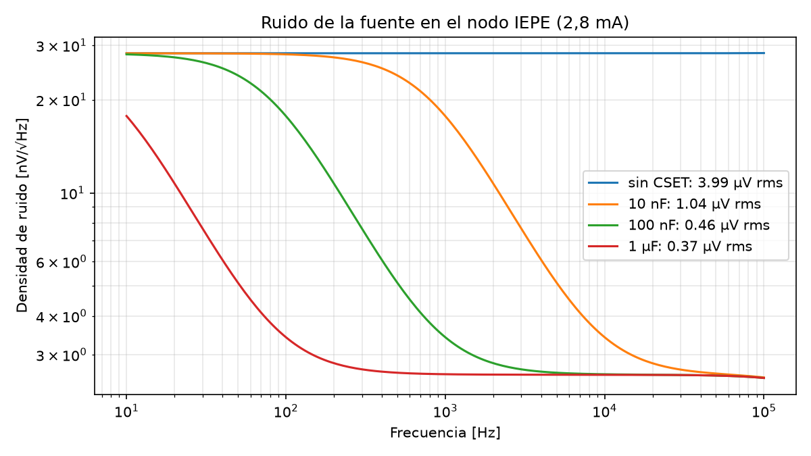
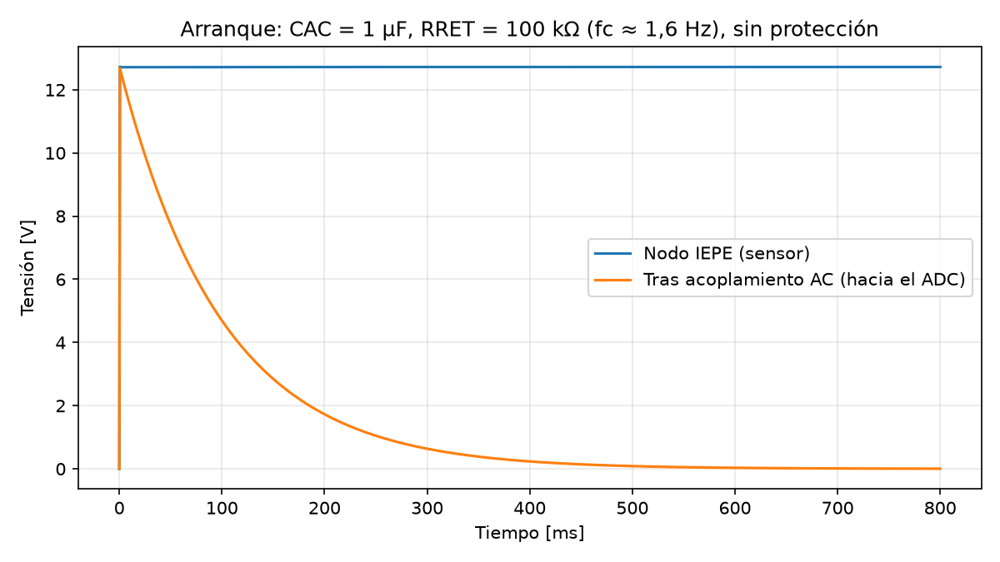

# Simulación de la fuente de corriente IEPE con LT3092

Fecha: 2026-10-27. Estado: **PROVISIONAL**. Son resultados de simulación en LTspice con el modelo del fabricante, no mediciones. No sustituyen la prueba T1 de banco ([tests](../tests/README.md)).

## Objetivo

Comprobar, antes de montar nada, si el LT3092 de Analog Devices (el mismo que usa ADI en su diseño IEPE [CN0540](https://www.analog.com/en/resources/reference-designs/circuits-from-the-lab/cn0540.html)) puede alimentar el micrófono ROGA RG-50 y entregar su señal sin degradarla. Se evalúan los factores que suelen faltar en los ejemplos: compliance, regulación con señal grande, rizado de la alimentación, ruido y arranque con el acoplamiento AC.

## Circuito simulado

```text
VIN (24 V) ── IN ┌────────┐ OUT ── ROUT ──┬── nodo IEPE ── 50 Ω ── sensor (bias + señal)
                 │ LT3092 │               │
                 └────────┘ SET ── RSET ──┘   (CSET opcional en paralelo con RSET)
```

`I_OUT = 10 µA · RSET / ROUT + 10 µA`, con RSET = 20 kΩ y resistencias de la serie E96:

| Corriente | ROUT | Corriente simulada |
| --- | --- | --- |
| 2,4 mA | 84,5 Ω | 2,377 mA |
| 2,8 mA | 71,5 Ω | 2,808 mA |
| 4,0 mA | 49,9 Ω | 4,019 mA |

El sensor se modela como una fuente de tensión (bias de 12,5 V más la señal) con los 50 Ω de impedancia de salida de la ficha del RG-50. Datos usados:

- Nivel máximo de 130 dB SPL, que la ficha ROGA da como **valor de pico** ("Max. Peak sound pressure level"): 63,2 Pa con **55,6 mV/Pa** (dato de la unidad en este repositorio) → **3,52 V de pico**. Se usa la sensibilidad mayor porque es el peor caso para el compliance.
- Piso de ruido de 32 dB SPL con **51,2 mV/Pa** (certificado de ejemplo de la ficha ROGA) → **40,8 µV rms**. Se usa la menor porque es el caso más exigente para el ruido.
- **OPEN:** las dos sensibilidades no coinciden; hay que confirmar cuál corresponde a nuestra unidad con su certificado.

## Resultados

### 1. Compliance: tensión mínima de alimentación



| Caso | VIN mínima (corriente dentro del 1 %) | Caída de VIN al nodo del sensor | Caída IN–OUT del integrado |
| --- | --- | --- | --- |
| Solo bias (12,5 V) | 14,0–14,1 V | 1,42 V | 1,22 V |
| Pico máximo (16,02 V) | **17,5–17,6 V** | 1,42 V | 1,22 V |

- Entre la alimentación y el sensor se pierden unos 1,42 V: 1,22 V en el propio integrado y 0,20 V en ROUT (10 µA × RSET). Esa caída prácticamente no depende de la corriente.
- Con **24 V** quedan unos **6,4 V de margen** sobre el pico máximo de 130 dB. Además, 24 V está dentro del rango de 18–30 V que exige el RG-50.
- Si se desconecta el sensor, el nodo sube hasta **24 V**. Un comparador con umbral cerca de 21 V (como en TI [TIDA-010249](https://ti.com/tool/TIDA-010249)) detectaría el cable abierto.

### 2. Señal grande en el tiempo



| Caso | Variación de corriente pico a pico | Corriente mínima |
| --- | --- | --- |
| 2,4 / 2,8 / 4,0 mA con VIN = 24 V | 0,076 % | sin caída |
| 2,8 mA con **VIN = 17 V** | 116 % | **0,18 mA** |

Con 24 V la corriente se mantiene constante durante todo el ciclo de un tono de 130 dB. Con 17 V la fuente deja de regular en los picos y la corriente cae casi a cero. Con el micrófono real eso sería **recorte de la señal**. El caso muestra por qué el compliance es un requisito y no un detalle.

### 3. Rizado de la alimentación que llega a la señal



| Corriente | Atenuación a 120 Hz | 50 mV de rizado a 120 Hz se convierten en | Impedancia de salida a 1 kHz |
| --- | --- | --- | --- |
| 2,4 mA | −113,5 dB | 0,11 µV | 3,9 MΩ |
| 2,8 mA | −112,0 dB | 0,13 µV | 3,3 MΩ |
| 4,0 mA | −108,9 dB | 0,18 µV | 2,3 MΩ |

A baja frecuencia el rizado de la red queda muy por debajo del piso del micrófono (40,8 µV). Por encima de unos 200 Hz la atenuación empeora 20 dB por década, hasta unos −53 a −58 dB a 100 kHz. Si los 24 V salen de un convertidor conmutado, su rizado de alta frecuencia sí pasaría. Por eso TI filtra su elevador con un regulador lineal (TPS7A49). Se recomienda una fuente lineal de banco o un LDO después del convertidor.

### 4. Ruido de la fuente



Ruido de la fuente en el nodo IEPE, banda de 20 Hz a 20 kHz, a 2,8 mA. La resistencia de 50 Ω del sensor se simula sin ruido para aislar la contribución del LT3092.

| CSET en paralelo con RSET | Ruido rms | Respecto al piso del micrófono |
| --- | --- | --- |
| Sin CSET | 3,99 µV | 9,8 % |
| 10 nF | 1,04 µV | 2,6 % |
| **100 nF** | **0,46 µV** | **1,1 %** |
| 1 µF | 0,37 µV | 0,9 % |

- Sin CSET el ruido ya está por debajo del micrófono. Al sumarse en cuadratura, solo eleva el piso unos 0,04 dB.
- Con CSET el ruido de la referencia interna se filtra con corte en `1/(2π·RSET·CSET)`: unos 80 Hz con 100 nF.
- **Propuesta: CSET = 100 nF.** Pasar de 100 nF a 1 µF casi no mejora el ruido y retrasa el arranque de la corriente (τ = RSET·CSET pasa de 2 ms a 20 ms).
- Para un sonómetro, CSET debería ser de película o cerámico C0G. Los cerámicos X7R son microfónicos: convierten las vibraciones en tensión.

### 5. Arranque y acoplamiento AC



Con un condensador de acoplamiento CAC = 1 µF, RRET = 100 kΩ (corte en unos 1,6 Hz) y **sin protección**:

- Al encender, la salida hacia el ADC recibe un salto de **12,7 V**, que tarda **unos 485 ms** en bajar de 0,1 V (τ = CAC·RRET = 100 ms).
- El PCM1808 admite unos 3 Vpp de entrada. Por tanto **es obligatorio** poner una protección o un limitador, además de un divisor o atenuador, entre el acoplamiento y el ADC. El firmware debe descartar al menos el primer medio segundo de cada arranque.

## Conclusión

Según la simulación, el **LT3092 es adecuado** como fuente de corriente IEPE para el RG-50 con esta configuración:

| Parámetro | Propuesta | Motivo |
| --- | --- | --- |
| VIN | 24 V, fuente lineal o LDO | 6,4 V de margen sobre el pico de 130 dB; dentro del rango de 18–30 V del RG-50 |
| Corriente | 2,8 mA (RSET 20 kΩ, ROUT 71,5 Ω) | Es la corriente indicada para la unidad; regula igual a 2,4 y 4 mA |
| CSET | 100 nF, película o C0G | Ruido de 0,46 µV, el 1,1 % del piso del micrófono |
| Salida hacia el ADC | Acoplamiento AC + protección + atenuación | Salto de 12,7 V al encender |
| Diagnóstico | Comparador de cable abierto (≈21 V) | Con el sensor desconectado el nodo sube a 24 V |

La fuente de corriente no limita el rango dinámico ni el ruido del sistema. Lo que sí hay que diseñar con cuidado es la alimentación (sin rizado de alta frecuencia) y la etapa entre el acoplamiento AC y el ADC.

## Limitaciones

- El modelo del LT3092 es el macromodelo cifrado de ADI. Representa el comportamiento típico, no la dispersión entre unidades, la temperatura ni el envejecimiento.
- El sensor es ideal: una fuente de tensión más 50 Ω. No modela su electrónica interna, su corriente mínima de funcionamiento ni su propio recorte.
- No incluye cable, conectores, disposición de la placa ni interferencias.
- La sensibilidad de la unidad debe confirmarse con su certificado: los datos disponibles van de 51,2 a 55,6 mV/Pa. La diferencia no cambia las conclusiones.

## Siguientes pasos

- Prueba **T1** en el laboratorio con cargas de prueba, sin micrófono, para medir la corriente, la caída en el LT3092 y el rizado reales y compararlos con esta simulación.
- Diseñar la etapa entre el acoplamiento AC y el ADC: protección contra el pico de encendido y atenuación al rango de entrada del conversor.
- Añadir la detección de cable abierto (comparador cerca de 21 V).

El reporte compacto en PDF para la entrega está en [`docs/reporte-lt3092/reporte.pdf`](reporte-lt3092/reporte.pdf) y no incluye estas limitaciones ni los siguientes pasos.

## Cómo reproducir

Requisitos: Wine, LTspice 26 (instalado con `wine msiexec /i LTspice64.msi` y con sus librerías actualizadas) y un entorno de Python con `spicelib`, `numpy` y `matplotlib`.

```bash
python3 -m venv .venv
.venv/bin/pip install spicelib numpy matplotlib
.venv/bin/python sims/lt3092/simulate.py
```

- Circuitos: [`sims/lt3092/circuits/`](../sims/lt3092/circuits/). Se pueden abrir también en LTspice.
- Script: [`sims/lt3092/simulate.py`](../sims/lt3092/simulate.py).
- Números: [`sims/lt3092/results.json`](../sims/lt3092/results.json).
- Gráficas: [`sims/lt3092/figures/`](../sims/lt3092/figures/).

Versiones usadas: LTspice 26.1.1, Wine 11.20, Python 3.14.8, spicelib 1.6.4, numpy 2.5.4, matplotlib 3.11.2.
